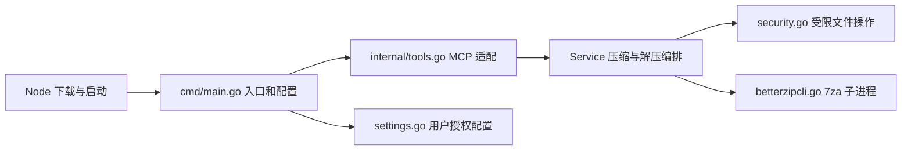

# BetterZip MCP 五项优化方案与分阶段实施计划

日期：2026-10-30（Asia/Taipei）。状态：OPT-1 已完成；OPT-2 的基线、决策和功能回归已完成，未引入生产优化；两个阶段的收尾质量检查已通过；OPT-3—OPT-5 待授权、未执行。

源码基线：`019a038383182e56c5bff6eb01350f9f3223296d`。本文中的项目位置均使用相对路径；实际操作必须先核实真实原项目。

## 1. 需求来源、当前授权与文档关系

用户本次要求：“先把这五项优化整理成完整方案和分阶段实施计划，保存到原项目，保持现有目录结构和接口兼容，暂时不要修改代码或运行检查。”

OPT-1 授权记录（2026-10-30）：用户要求按本文仅实施 OPT-1，随后运行针对性功能测试并更新计划；只在真实原项目修改，保持目录和接口兼容。不运行 lint、vet、modern、race、覆盖率等质量检查，不进入下一阶段，不提交或发布。

OPT-2 授权记录（2026-10-30）：仅继续 OPT-2，先测解压性能基线，根据实测做最小优化，有收益才保留；保持原目录、接口和安全约束，完成后运行针对性功能测试并更新本文。当轮不运行质量检查、不进入 OPT-3、不提交或发布，并保留全部 OPT-1 未提交改动。

收尾授权记录（2026-10-30）：用户接受“先收尾并提交，暂不发版”的建议，要求“按你推荐的做”。本轮完成 OPT-1 / OPT-2 的质量检查、最终差异核对和阶段性提交；不推送、不打标签、不发布，也不进入 OPT-3。收尾步骤及实际证据见 12.4。

发布最新授权（2026-10-30）：用户要求“发版并 push”。本轮发布当前 OPT-1 / OPT-2 成果到 GitHub，并推送源码与版本标签；沿用此前 npm 暂缓的范围，不发布 npm，不进入 OPT-3。版本、步骤和验收见 12.5。

- 最初编制阶段仅授权保存和回读本文件，未修改代码或执行检查。各轮新增授权以最新授权段为准，不自动延伸到下一阶段。
- 后续代码实施、功能验证、性能测量、构建及客户端操作按届时明确授权执行。保存本文不构成实施授权；历史授权不自动扩展到本专项。
- [task_plan.md](task_plan.md)、[findings.md](findings.md)、[progress.md](progress.md) 保留原有历史内容、阶段编号和结果。本文是新增专项计划，不重排或续跑其中的阶段 1—9。
- 本专项五个阶段严格对应上一轮评审的五项建议，编号为 OPT-1—OPT-5。任何步骤未执行、未验证或缺少条件，都不得标记为通过。
- 方案依据为本次读取的源码、配置、历史错误记录和上一轮只读评审。上一轮的代码推导及历史测试记录均不是本专项的新测试结果。

| 阶段 | 对应优化项 | 当前状态 |
| --- | --- | --- |
| OPT-1 | 明确产物已完成、清理失败的返回语义 | 通过：原项目实现、针对性功能测试及文档更新完成 |
| OPT-2 | 评估并优化逐文件解压的扩展成本 | 通过：完成评估与功能回归；3 组容量超时单列，没有生产优化改动 |
| OPT-3 | 增强机器可读的工具结果 | 待授权，未实施、未验证 |
| OPT-4 | 补充轻量进度与可解释性 | 待授权，未实施、未验证 |
| OPT-5 | 建立明确、可重复的验收入口 | 待授权，未实施、未验证 |

## 2. 已确认的现状与问题依据

### 2.1 架构及版本

当前是单进程、本地 stdio MCP 服务，`internal` 下的 Go 文件属于同一个 `betterzip` 包。下图是逻辑职责，不表示新增目录、包或服务。



| 项目 | 当前源码事实 | 本计划约束 |
| --- | --- | --- |
| Go module / 语言版本 | `github.com/gtkit/betterzip-mcp` / `go 1.27.0` | 不更换 module，不升级语言版本 |
| MCP 依赖 | `github.com/mark3labs/mcp-go v1.4.0` | 保持锁定；新增协议能力先核实该版本实际 API |
| 其他 Go 依赖 | jsonschema-go v0.4.2、google/uuid v1.6.0、jsonschema/v6 v6.0.2、cast v1.7.1、uritemplate/v3 v3.0.2、x/text v0.41.0 | 保持当前 go.mod/go.sum，不因本计划新增或升级依赖 |
| 程序 / npm / 插件版本 | 当前均为 0.1.0 | 本次文档不改版本；后续发布版本另行确定，不覆盖已发布版本 |
| 支持环境 | macOS，amd64 / arm64；Node 壳要求 Node >=20 | 保留现有平台范围和直接运行 Go 二进制的方式 |
| 授权设置 | CLI `--root` > 非空 `BETTERZIP_MCP_ROOT` > 用户保存的设置；没有设置不授权 | 不改变优先级、保存格式和默认拒绝行为 |
| 后端 | BetterZip 随附的 7za，或用户显式指定的可信 helper | 不切换为 GUI 异步 CLI，不安装或更新 BetterZip |

表中依赖的简称以 [go.mod](go.mod) 中完整路径为准。历史记录中的本机工具版本和已通过结果只用于理解背景；本轮没有重新运行工具或验证环境。

### 2.2 五项问题的事实边界

| 编号 | 源码依据 | 可以确认的结论 | 尚未确认 |
| --- | --- | --- | --- |
| F1 | `internal/betterzipcli.go` 的 Compress、Extract 及多个 defer；`internal/tools.go` 的错误分支 | 产物已形成后，资源关闭或临时数据清理错误仍可使最终 error 非空；MCP 错误分支不返回成功路径 | 故障发生频率；本专项尚未注入故障复现 |
| F2 | Extract 在条目循环中调用 `s.run`；run 每次发现 helper、定位自身程序并启动子进程 | 成功提取 N 个普通文件需要 N 次提取命令，另有一次列表命令；1,000 个普通文件对应 1,001 次命令调用，是代码计数推导 | 实际耗时、solid 7z 的解码成本、可获得的优化收益 |
| F3 | `internal/tools.go` 使用文本结果和 IsError；会员工具也返回非错误文本 | 调用方没有统一、稳定的操作状态、产物位置、警告及错误码对象 | 锁定 SDK 与各客户端对增量结构化字段的实际支持 |
| F4 | 入口设置 2 个 worker、队列长度 16；Service 有总超时，未提供阶段通知 | 已有并发和取消边界，但缺少阶段进度、处理数量和统一统计 | 客户端进度显示方式及慢客户端对发送路径的影响 |
| F5 | `package.json` 的 test 仅运行 install.test.js；源码存在 Go、协议和 Codex 验收测试；当前清单无 CI workflow | 测试类型已经存在，但入口分散；发布核对主要依赖人工命令组合 | 新增状态的测试结果；Apple Silicon 及其他客户端的新实机证据 |

参考 OCR 的目的仅是借鉴确定性流程、结构化结果和可重复验收：其 [选择逻辑](https://github.com/alibaba/open-code-review/blob/main/internal/agent/selection.go) 让预览与执行复用规则，其 [架构文档](https://github.com/alibaba/open-code-review/blob/main/pages/src/content/docs/en/architecture.md) 描述了阶段事件，其 [CI 配置](https://github.com/alibaba/open-code-review/blob/main/.github/workflows/ci.yml) 固定了验证入口。本文不采用其模型编排、会话持久化、容器或目录布局。

## 3. 目标、非目标与兼容契约

### 3.1 可验收目标

1. 对每次调用区分“是否形成有效产物”和“清理是否成功”；已完成产物不因清理失败被误删，调用方能够识别不可盲目重试的结果。
2. 得到逐文件解压的真实基线，并仅合入有测量收益、保持安全及资源边界的优化；没有证据时不承诺加速。
3. 在保留现有调用方式和文本结果的基础上，提供可由程序读取的状态、错误码、产物位置和警告。
4. 仅向请求进度的调用发送轻量通知；统计有明确含义，断开、取消、慢客户端不拖住归档操作。
5. 用独立、显式入口覆盖单元、真实后端、协议、客户端和发布产物核对，清楚区分缺失前提、失败和通过。

### 3.2 非目标

- 不调整现有目录层级、Go 包划分、模块位置或依赖方向；不引入通用任务引擎、数据库、消息队列、远程服务或 LLM。
- 不新增公共 MCP 工具、必填参数、授权配置、后台任务 API、断点续作或自动重试。不实现加密压缩、分卷或会员验证。
- 不为预览新增公开接口；本计划只复用内部预检结果解释当前操作。独立 preview / dry-run 接口留待另一个明确需求。
- 不扩大授权根，不自动修改客户端配置，不自动安装插件、下载工具或切换后端。
- 不新建 CI 目录、自动触发工作流或复制 OCR 的检查集合；不替用户设定覆盖率门槛。
- 不自动提交、发布、打标签、改版本、升级依赖或创建项目副本。既有发布与 npm 暂缓状态不由本文改变。

### 3.3 必须保留的接口与行为

| 接口 / 行为 | 兼容要求 |
| --- | --- |
| 四个工具 | 保留 betterzip_compress、betterzip_extract、betterzip_encrypt_compress、betterzip_split_compress，名称和数量不变 |
| 压缩参数 | 保留 working_dir、output_archive、sources；不改变必填规则、路径基准和数量约束 |
| 解压参数 | 保留 archive_path、output_dir；目标仍须不存在且父目录已存在 |
| 会员参数及行为 | 保留 password / split_size 的现有校验；仅提示，不访问 helper、不形成产物、不保存或回显密码 |
| Go 调用 | 保留 New、Config、Compress、Extract、Close、RootPath 及现有导出函数签名；保留 `(string, error)` 返回方式 |
| 错误识别 | 保留 ErrInvalid、ErrUnsafe、ErrLimit、ErrNotConfigured 和 CommandError；包装不得破坏 errors.Is / errors.AsType 的识别 |
| 文本返回 | 普通成功文本、会员提示文本不变；既有错误原因保留。仅在已完成但有清理问题等复杂结果中增加明确解释，不依赖调用方解析文字 |
| IsError | 保持现有分类：普通成功和会员提示为 false；操作失败、取消、超时及原本会返回清理错误的情况仍为 true |
| stdio | stdout 只写合法 MCP 消息；帮助、诊断写 stderr；通知必须由协议发送通道序列化，不直接写 JSON 到 stdout |
| 文件安全 | 保留 os.Root、路径与链接校验、独占创建、不覆盖、输入固定、逐条大小核对；7za 不取得用户解压目标目录 |
| 设置及启动 | 保留 setup、已有 flags、环境变量、用户配置格式、Node 启动与信号转发；不修改真实用户设置 |

“清理错误仍 IsError=true，但结构化状态表明产物已完成”是兼容性取舍：旧调用方仍看到原有错误，新调用方得到明确产物及重试信息。将这类结果改成 IsError=false 属于进一步行为变化，不在本方案默认范围内。

## 4. 候选方案与推荐

| 候选 | 正确性及兼容风险 | 规模与性能 | 实施 / 维护成本 | 回滚与影响面 |
| --- | --- | --- | --- | --- |
| A：在现有包与文件内增加明确结果、生命周期和少量包内辅助函数（推荐） | 保留外部接口；重点证明提交及清理次序、增量协议兼容 | 可分别测量并优化准备、复制和执行开销；不预设吞吐收益 | 修改现有实现与测试；不新增基础设施。人日未估算，不承诺工期 | 可逐阶段撤回；主要影响两种免费操作和 MCP 适配 |
| B：拆分通用归档引擎、任务调度器和后端插件体系 | 变更面大，增加状态及适配层；超出当前目录和架构约束 | 潜在批处理能力尚无本项目数据支撑 | 需要新的抽象、接口与维护责任 | 回滚横跨模块；当前不采用 |
| C：只补说明，完全保留实现 | 不引入运行变化，但产物状态和机器判读问题仍存在 | 解压调用次数与运行反馈维持现状 | 最低；不能满足五项后续优化目标 | 文档可撤回；仅作为当前代码基线 |

推荐 A。只在测试确有需要时增加局部可注入函数，禁止包级可变测试钩子和为假设后端新增接口层。目录、配置、依赖不随重构扩展。

## 5. OPT-1：产物状态、提交与清理

### 5.1 设计决策

将“操作结果”和“资源收尾”分开记录。在 `internal/betterzipcli.go` 内设计未导出的最小结果类型，保存提交状态、有效输出位置、主要失败与清理警告。现有导出方法仍适配为 `(string, error)`；MCP 层同包访问必要的详细结果，不通过解析错误字符串恢复状态。

若需要私有详细执行方法，现有 Compress / Extract 只作薄适配，业务逻辑仅保留一份。名称和字段是实施设计内容，不视为已经存在的 API。

逻辑状态：准备 → 执行 → 验证 → 已提交；任意提交前失败进入失败收尾。资源清理在所有终态后独立执行，不反向改变已经确认的提交状态。

- 压缩提交点：输出已经生成且主写入验证成功，现有 `Root.Link` 独占发布成功。此后清理错误不得删除最终压缩包。
- 解压提交点：全部条目校验和文件写入、必要的文件关闭完成，输出目录句柄的收尾结果已明确，然后标记逻辑提交。目录在操作期间仍可见；本文不承诺整个目录原子出现，也不新增目录重命名方案。
- 提交前失败：先保留主要错误，再尝试删除本次明确创建的未完成输出和临时数据。未创建、预先存在或归属不明的对象不得删除。
- 提交后失败：保留已完成输出，记录独立清理诊断；保留底层 cause，返回产物位置和禁止盲目重试的解释。
- 取消 / 超时：提交前终止进程并失败收尾；提交后保留结果并明确提交已发生。不要用一次晚到的 ctx.Err 抹掉提交事实。
- 不增加自动重试、崩溃后自动删除残留或后台清理器。异常进程终止后的状态可能无法由内存结果判定，继续要求调用方检查目标。
- “已提交”表示本次逻辑操作形成了有效产物，不等价于断电持久性；不宣称现有行为具备完整 fsync 保证。

### 5.2 终态及兼容映射

下表描述目标映射。OPT-1 已落实内部提交 / 清理结果及必要文本解释；status、retryable 等结构化字段仍待 OPT-3，本表不代表这些字段已通过 MCP 返回。

| 场景 | 产物认定 | 目标状态 | IsError | 返回及清理要求 |
| --- | --- | --- | --- | --- |
| 正常成功 | 有效输出已提交 | completed | false | 保留现有成功文本，返回输出位置 |
| 已提交，资源清理失败 | 有效输出保留 | completed_with_warning | true | 保留原错误原因，说明产物已完成并给出位置；retryable=false |
| 参数 / 授权 / 路径拒绝 | 未执行提交 | rejected | true | 不新建结果；保持对应哨兵错误 |
| 执行 / 验证失败，清理成功 | 无有效输出 | failed / cancelled / timed_out | true | 回收进程及本次未完成数据；保留主要错误 |
| 执行失败且未完成数据无法清理 | 不作为有效输出 | failed_with_residue | true | 同时记录主要失败、清理失败和残留位置；retryable=false |
| 会员提示 | 没有执行归档 | not_executed | false | 保留现有提示及参数校验，不创建 job、不记录或回显密码 |

`output_path` 只用于已确认的有效产物；失败残留使用单独字段，不能伪装成成功结果。路径在新增结构化字段、日志和报告中采用授权根相对表示，避免写出本机目录；原有用户可见成功文本保持兼容。

### 5.3 实施步骤

| 步骤 | 前置条件 | 具体工作 / 文件 | 核对方式与可复核证据 | 停止条件 | 交付物 / 状态 |
| --- | --- | --- | --- | --- | --- |
| OPT-1.1 | OPT-1 已获实施授权；已重读本文、源码和错误记录 | 枚举每个 return、defer、文件创建、Link 和关闭点；冻结内部状态及兼容映射 | 调用链及失败点表；核对 Compress / Extract 调用方 | 发现必须改变公开签名、目录或文件授权范围 | 通过；细化见 5.4 |
| OPT-1.2 | 1.1 已完成 | 在 betterzipcli.go / security.go 明确提交与收尾；tools.go 增加复杂结果解释；只引入必要的局部辅助函数 | 回读修改函数和调用方；提交前后、关闭及清理失败的故障注入列入 1.3 | 必须吞掉 cause、放宽校验或删除归属不明对象才能完成 | 通过；公开签名、工具 schema 和依赖未变 |
| OPT-1.3 | 已获对应测试授权；1.2 完成 | 复用 integration_test.go 夹具；必要时在现有 internal 目录拟新增 betterzipcli_test.go，专测生命周期 | 新旧 Go 调用、errors.Is / AsType、产物存在性、旧目标不变、无重复清理破坏；记录命令和退出码 | 状态与磁盘事实不符；主要错误或清理错误丢失 | 通过；实际命令和范围见 5.5 |
| OPT-1.4 | 1.3 通过 | 仅更新本文状态和 README 的失败语义；记录明确变更及回滚点 | 文本、代码、实际用例三者一致；未执行部分保持未验证 | 必需验收缺失或有未解决失败 | 通过；仅完成 OPT-1，未提交或发布 |

### 5.4 本轮执行细化（代码修改前冻结）

- 已回读本文、现有错误记录和 Compress / Extract / closeJob / toolError 的全部实现；原项目基线无已跟踪文件修改，本文为先前创建的未跟踪文档。实际 Go 为 go1.27.3 darwin/amd64，module 和依赖未变。
- 保留 Service、Config、Compress、Extract、NewMCPServer 的对外签名。最小内部结果记录提交标记、根内相对产物路径、清理错误和残留路径；需要返回清理失败时，通过未导出错误包装携带结果，并保留底层 cause。
- 测试注入只限单个 Service 实例的私有关闭 / 删除函数；生产缺省调用原生 Close / Root.RemoveAll，各操作开始时取其本地值。没有包级可变钩子、新配置、后端替换或外部依赖。
- MCP 继续调用原有公开方法；toolError 从错误链读取内部结果。已提交但清理失败保留 IsError=true，明确显示根内相对产物位置和不要直接重试；未提交且清理失败报告残留，不能称为有效产物。普通成功、普通错误和会员提示不变。不实现 OPT-3 字段或 OPT-4 通知。

| 资源 / 时点 | 本轮处理 | 对应验收 |
| --- | --- | --- |
| 压缩 Root.Link 成功前 | 复制、执行、验证和取消错误为主要失败；仅清理本次 job | 原目标及源文件不变，无成功路径 |
| 压缩 Root.Link 成功后 | 标记已提交；input / 目录描述符 / job / work 的关闭或删除失败单独合并 | 产物保留，返回路径及错误链；MCP 明确已完成 |
| 解压每个文件的写入、关闭及最终输出目录关闭 | 均在逻辑提交之前完成；只关闭一次；最终取消检查通过后标记提交 | 写入、大小不匹配、文件或输出目录关闭失败会回收本次输出 |
| 解压未提交输出回收 | 根据提交标记和本次创建事实决定删除，不依赖包含清理错误的最终 error | 删除失败保留主要错误及残留相对位置；既有目录不被删除 |
| 解压提交后的 job / parent 收尾 | 清理失败不撤销提交；记录 job 删除失败产生的残留 | 已完成目录内容保持可读、重试不会覆盖或删除它 |
| 提交后发生取消 | 已发生的提交保持有效；不把晚到取消改写成未完成 | 定时无关的取消注入，返回产物与实际文件一致 |

针对性功能测试拟在 internal 包运行（含 integration 标签），覆盖两种真实归档、原有安全 / 取消 / 会员用例，以及新增的提交后删除失败、提交前关闭失败、多错误及回滚失败、晚到取消、重复调用和实际 MCP handler。只运行普通 Go 测试，显式 -vet=off；不生成发布二进制，不执行旧安装流程。测试数据及编译临时数据均限定在原项目，构建使用 -trimpath，记录和报告不保存本机路径。

上述细化在代码修改前已保存并回读；随后完成 OPT-1.2—OPT-1.4。仓库外 Go 消费者未检索，使用现有签名和错误识别兼容约束控制影响，不声称覆盖全部外部调用方。

### 5.5 本轮执行记录

- 首次测试启动请求在创建进程之前被工具安全检查拒绝，原因是命令中的 `rm -rf` 临时目录清理形式；Go 测试没有运行，不存在测试退出码。改为由 Python TemporaryDirectory 管理原项目 dist 内本次新建目录，测试结束只清理该目录；不扩大清理范围，也不重复被拒绝的命令形式。
- 原项目实际修改：internal/betterzipcli.go、internal/security.go、internal/tools.go；新增 internal/betterzipcli_test.go（integration 标签）；同步 README.md 及本文件。没有移动文件、增加目录层级、修改依赖 / 配置 / 版本或增加 MCP 工具。
- 实现结果：清理错误通过 operationError 包装并保留 cause；operationResult 独立保存提交事实和根内相对位置；解压失败回收由提交标记决定，输出关闭先于提交；关闭失败与删除失败分开，只有删除失败才列为残留。
- 调用方回读：两个免费 MCP handler 仍调用原有公开方法，toolError 读取内部错误结果并维持 IsError=true；普通成功及两项会员提示保持原样。现有 Go 集成调用继续使用 `(string, error)`，新测试明确核对非空产物路径加错误的兼容结果。
- 实际功能测试命令：`GOTOOLCHAIN=local GOPROXY=off go test -trimpath -vet=off -count=1 -timeout=90s -tags=integration ./internal`。TMPDIR / GOTMPDIR 由运行时指向原项目 dist 内 TemporaryDirectory，本文件不保存实际目录。退出码 0；输出为 `ok github.com/gtkit/betterzip-mcp/internal 3.140s`。临时编译目录由该上下文清理，没有保留新的发布二进制。
- 环境：本机 Go 1.27.3，darwin/amd64；go.mod 的 Go 1.27.0、mcp-go v1.4.0 等依赖保持原值。真实默认 BetterZip helper 已在 ZIP/7z 往返与恶意归档用例中执行；本轮未另行探测其版本，不把历史 helper 版本视为本轮检测结果。
- 新增五个测试入口覆盖：提交后关闭 / 删除失败及重复调用、提交前文件 / 输出目录关闭失败、执行与关闭及回滚多重错误、提交前后取消边界、通过实际 NewMCPServer 注册 handler 验证正常文本及错误文本。原有真实归档、路径 / 链接 / 大小限制、取消 / 超时 / 退出码、会员及设置用例随 internal 包测试运行并通过。
- 验收边界：故障分支用单实例关闭 / 删除注入及既有受控 helper，真实归档路径使用本机 7za；不是操作系统实际损坏或真实磁盘故障的证明。MCP 证据来自真实注册 handler，不冒充桌面客户端连接或 UI 验收。未运行 lint、vet、modern、race、覆盖率、性能测试、Node / Codex 安装与验收、双架构发布构建或打包。
- 回滚：仅撤回本轮三个实现文件的对应补丁及新增测试，再同步撤回 README 的 OPT-1 说明；保留先前完整方案和其他用户内容。没有需要回滚的设置迁移、安装、提交或发布。新的二进制与已安装插件未更新，运行中的旧服务不会自动获得本次源码改动。

## 6. OPT-2：解压成本基线与安全优化

### 6.1 先量化再决定修改

保持逐条列表校验、stdout 流提取、实际字节核对和总预算。当前数据不足以选择批量解压实现。推荐先测量准备、复制、列表、提取、关闭及清理分别占用的时间，再评估每次操作复用已解析的 helper / 自身程序位置等小范围优化。

候选 A 保留逐文件进程，减少有测量意义的重复准备开销；候选 B 采用一次批量 stdout 提取。B 的条目顺序、边界、零字节文件、失败定位、CRC 和取消语义尚未核实，当前不采用。更换 backend、直接将用户目标目录传给 7za、提高并发掩盖重复解码，都不是本计划的实现路径。

若只解析一次 helper，应限定在单次操作内，下一次调用重新发现；不增加跨调用永久缓存。准备工作仍纳入现有总 timeout。不能仅据路径复用声称消除了所有可执行文件替换竞争。

### 6.2 资源模型与测量矩阵

以下是静态上限或计划输入，不是本次测量结果。

| 项目 | 当前边界 / 推导 | 需要采集的证据 |
| --- | --- | --- |
| 并发 / 队列 | 每个服务进程 2 个 worker、队列长度 16；不改变默认值 | 两个并发任务互不混入源文件、输出或临时数据；取消可完成 |
| 超时 | 每次免费调用 5 分钟默认总预算；不能把每个文件重新计为 5 分钟 | 准备、复制、列表和提取共享预算的用例 |
| 字节及条目 | 默认 4 GiB，上限可配置至 1 PiB；最多 10,000 条；列表 4 MiB，诊断 64 KiB | 既有边界及边界外拒绝保持一致 |
| 进程次数 | 正常提取 N 个普通文件为 N+1 次 helper 命令；目录不执行提取命令 | 实际启动计数与阶段耗时 |
| 临时磁盘 | 压缩新增量约为 S+A；解压新增量约为 A+U。S=输入复制字节，A=归档字节，U=输出字节；尚未计文件系统元数据及 helper 临时开销 | 单次及两个并发任务的峰值额外占用；不能仅凭 MaxBytes 推导总磁盘上限 |
| 内存 | 列表和诊断有上限，但条目对象、Go 运行时及 7za 内存并未由这些上限完整约束 | 服务与 helper 的实际峰值；不填写未经测量的内存数字 |
| 网络 / DB / QPS | 归档执行链不依赖网络或数据库；没有本项目峰值 QPS 数据 | 本阶段以本地文件数、字节、耗时和并发数评价，不套用 Web 服务容量模型 |

拟定样本：ZIP、非 solid 7z、solid 7z；普通文件数 1 / 100 / 1,000 / 10,000；小文件 1 KiB，单大文件 1 / 64 / 256 MiB。超出列表或时间边界的样本记录为明确拒绝或超时，不修改边界让样本通过。所有数据在原项目内使用本次生成的测试数据，结束时仅清理本次创建的内容。

每组先预热 1 次，再记录至少 5 次有效运行的中位数、最小值和最大值；不以 5 个样本声称稳定 P95。记录架构、helper 版本、归档参数、输入散列、运行命令和退出码，落盘前脱敏。

优化合入目标：主要瓶颈场景的中位数至少改善 10%，其他代表场景没有超过 5% 的可重复退化；安全、字节一致、取消和资源上限全部保持。数字是拟定验收目标，不是性能承诺。若基线自然波动已达 5%，先增加取样并在本文记录测量方法修订，不据噪声判断改善。没有可证明收益时，交付测量结论并保留现实现，性能修改不能记为通过。

### 6.3 实施步骤

| 步骤 | 前置条件 | 具体工作 / 文件 | 核对方式与可复核证据 | 停止条件 | 交付物 / 状态 |
| --- | --- | --- | --- | --- | --- |
| OPT-2.1 | OPT-1 已验收；OPT-2 和测量已获授权 | 在现有 integration_test.go 增加必要基准或复用夹具；先固定输入和分段测量口径 | 输入清单、散列、版本、基线样本和计数；报告置于现有 dist 内并脱敏 | 没有可用原生 helper、样本安全性未确认、资源不足 | 通过：21 组已尝试，18 组取得样本，3 组超时如实记录 |
| OPT-2.2 | 基线有效 | 对比准备、I/O、进程和解码成本，选定仅有证据支持的改动；冻结具体改动点 | 记录候选收益、风险、涉及函数和接受标准 | 必须改架构、依赖、提取安全方式或公共接口 | 通过：准备复用估计上限约 0.0144%，不选择无足够收益依据的生产候选 |
| OPT-2.3 | 2.2 范围已确认且仍在本计划内 | 在 betterzipcli.go / 必要安全辅助函数内做最小改动 | 同样本前后比较；重跑该变更涉及的边界和取消用例 | 任一安全回退、输出不一致或收益不足 | 不适用：未选中生产候选；没有实施生产优化或宣称 A/B 加速 |
| OPT-2.4 | 比较完成 | 接受有证据的改动，或明确记录保留旧实现；说明规模边界 | 保留完整比较和未达标项；不以理论调用次数冒充耗时 | 尚有不稳定结果或必要数据缺失 | 通过：保留原实现，功能回归退出 0；未进入 OPT-3 |

### 6.4 本轮测量细化与记录

- 原项目仍为基线提交加 OPT-1 的未提交实现，先前改动全部保留。测量前仅扩展现有 integration_test.go 的基准及供其复用的测试辅助函数，不修改生产提取逻辑。
- 两次技能读取发生路径错误：误读未列出的技能目录，以及把文档中的 benchmark.md 写成 benchmarks.md，均返回不存在；已改为读取会话明确给出的 go-performance/SKILL.md 和其中引用的 benchmark.md。没有安装、复制或修改任何技能；后续只使用已确认路径。
- 使用真实 Service.Extract、默认 5 分钟单次预算与 4 GiB 限制；所有输入、输出及编译临时文件位于原项目。测量 fixture 采用确定性数据，记录输入散列、真实 helper 版本和生成参数，不将副本作为开发项目。
- 第一轮执行原计划的 21 个场景：三种格式分别覆盖 1 / 100 / 1,000 / 10,000 个 1 KiB 文件，以及单文件 1 / 64 / 256 MiB。每组预热一次、至少五次独立提取；校验输出在计时外完成。样本发生超时或资源不足时记录实际失败，不放宽限制、不伪记有效样本。
- 补充测试侧阶段诊断，分别测量输入固定、列表、解析、逐条提取及清理，调用相同底层函数；明确它是阶段定位数据，不能代替真实 Extract 总耗时。准备函数可另做微基准用于估算其收益上限。
- JSONL 原始样本及 benchstat 文本存入现有 dist；记录和子进程输出写盘前去除真实原项目、用户和测试目录。只保存数值、版本、相对文件名、散列和脱敏诊断。
- 生产候选必须在基线有效后写明具体差异再实施。优先评估单次操作准备复用；若测量显示大文件写入成本明显，可评估有固定内存上限、保持逐条字节限制及提交前错误处理的 I/O 改动。批量提取、后端替换和并发上限变更不在本轮范围。
- 对候选在相同输入与参数下比较独立样本，使用本机已有 benchstat；初始样本不足或噪声影响判定时补充数据。未达本文收益门槛或出现功能 / 安全回退时，只撤回 OPT-2 候选，不覆盖 OPT-1。
- 启动前已确认 Go 1.27.3 darwin/amd64、原目录约有 50 GiB 可用空间；当时尚未运行基线、候选或功能测试。后续真实结果按下面执行记录保留，不以启动前状态代替当前结论。

基线执行中记录：

- benchstat 实际 module 版本为 golang.org/x/perf v0.0.0-20260908200009-22c9c6c9d4da，构建 Go 1.27.1；没有安装或更新工具。
- 采用 `go test -trimpath -vet=off -run=^$ -bench=^BenchmarkExtract$ -benchtime=5x -count=1 -timeout=45m -tags=integration ./internal`，仅运行解压基准；GOTOOLCHAIN=local、GOPROXY=off，编译临时数据由原项目 dist 内的 TemporaryDirectory 管理。
- 基线源码散列存于 dist/opt2-source-baseline.json；原始逐次样本存于 dist/opt2-baseline.jsonl；命令输出经路径脱敏写入 dist/opt2-baseline-output.txt。此时生产执行路径未做 OPT-2 改动。
- 已实际观察到 ZIP 10,000 个 1 KiB 文件在预热中返回 context deadline exceeded；维持 5 分钟默认限制，没有将失败计为成功样本。基准命令仍继续其余场景，最终退出状态尚未取得。
- dist/opt2-resource-samples.json 保存该预热期间 3 次、间隔 5 秒的 RSS 采样：测试进程约 24 MiB、子进程最高观察约 6.5 MiB。这不是保证峰值，也不等于独立发布进程的内存基线。
- 全矩阵已结束，命令退出 1、耗时 1669.017 秒：18 组各有 5 个有效样本且通过文件数、大小和内容散列校验；三种格式的 10,000 文件组均在预热时达到默认超时，没有有效样本。退出 1 对应这三个容量边界，不能记作全矩阵通过。
- 合成数据定义：PCG(1,2) 生成 32 KiB 固定块，文件重复该块，各文件内容相同；这些是可复现的合成输入，不代表所有真实归档。接下来的对比复测固定输入访问 / 修改时间以减少归档元数据差异，原始基线文件保持不变。

### 6.5 基线结果与优化决策

以下为真实 Extract 调用的中位数，时间单位为秒。成功组均为 5 个有效样本；10,000 文件组在预热时失败，没有中位数。

| 格式 | 1 × 1 KiB | 100 × 1 KiB | 1,000 × 1 KiB | 10,000 × 1 KiB | 1 × 1 MiB | 1 × 64 MiB | 1 × 256 MiB |
| --- | --- | --- | --- | --- | --- | --- | --- |
| ZIP | 0.0607 | 3.4146 | 34.8826 | 默认超时 | 0.0661 | 0.2319 | 0.5609 |
| 7z 非 solid | 0.0675 | 3.5890 | 35.0528 | 默认超时 | 0.0680 | 0.2382 | 0.5945 |
| 7z solid | 0.0731 | 3.2140 | 35.0388 | 默认超时 | 0.0647 | 0.2323 | 0.7251 |

- 阶段探针使用同样底层函数，在三个 1,000 文件场景中实际执行 1,001 次 helper 调用；逐条提取阶段占探针所记录阶段时间的 99% 以上。该阶段同时包含进程启动、解码及输出写入，不能把全部耗时归因于某一个子因素。
- 准备函数微基准运行 10 次，每次至少 100 ms，实际中位数为 5,018.5 ns/op。使用 ZIP 1,000 文件的实测 34.8826 秒计算，即使完全消除 1,001 次准备工作，估计最多减少约 5.02 ms（0.0144%）。这是基于微基准的上限估算，不是已实现的端到端收益。
- 因此不实施准备缓存或 runner 抽象；现有数据也不足以支持缓冲、批量提取或并发调整。没有进行生产代码前后 A/B，也没有宣称某项实际加速。三个生产实现文件的 SHA-256 与 OPT-1 基线逐项一致，证据写入 dist/opt2-summary.json。
- 保留现有逐条流式提取、os.Root、独占创建、字节 / 条目校验、进程取消和 OPT-1 的提交 / 清理语义。基准与报告保留用于后续重现，不以制造代码改动作为阶段完成标准。
- 原始样本和汇总：dist/opt2-baseline.jsonl、dist/opt2-baseline-output.txt、dist/opt2-summary.json、dist/opt2-stages.jsonl、dist/opt2-preparation-output.txt、dist/opt2-resource-samples.json。阶段探针命令退出 0，耗时 111.921 秒；准备函数命令退出 0，耗时 1.879 秒。
- benchstat 只用于汇总基线，输出为 dist/opt2-benchstat-summary.txt，退出 0；其明确警告每组 5 个样本不足以给出 95% 置信区间。本文保留中位数和原始范围，不声称可靠 P95、统计显著加速或两实现等价。没有生产候选需要据此接受，故不为虚构收益反复追加端到端样本。
- 测量范围为本机 Intel、Go 集成测试宿主及真实 7za 26.03 x64，文件系统已预热；不是已安装客户端的全链路延迟或 Apple Silicon 实机数据。随后已完成针对性功能回归，结果见 6.6，本轮在 OPT-2 结束。

### 6.6 复测入口及最终验收

实际新增内容只在现有测试文件：integration_test.go 增加 BenchmarkExtract、BenchmarkExtractStages、BenchmarkExtractPreparation 和必要辅助函数；security_test.go 的 testDir / testService 接受 testing.TB 以复用原目录夹具。三个生产实现文件、MCP schema、配置、依赖和版本均未改动，OPT-1 的未提交实现保留。

基准专用环境变量（不是服务配置，普通运行不会读取）：

| 变量 | 用途及默认行为 | 复测示例 / 约束 |
| --- | --- | --- |
| BETTERZIP_MCP_BENCH_REPORT | 指定追加 JSONL 原始记录的位置；未设置则不保存 JSONL | 从原项目根运行时可用 dist/opt2-new-run.jsonl；使用新文件保留旧证据，父目录须存在，不能写入真实个人目录字符串 |
| BETTERZIP_MCP_BENCH_LABEL | 为 fixture / sample 记录标识本次实验；未设置则为空 | baseline / diagnostic 等非敏感标签，不影响服务行为 |

从原项目根复测完整矩阵的示例命令（本轮实际使用了临时目录管理和输出脱敏包装）：

```text
BETTERZIP_MCP_BENCH_REPORT="$PWD/dist/opt2-new-run.jsonl" BETTERZIP_MCP_BENCH_LABEL=baseline go test -trimpath -vet=off -run='^$' -bench='^BenchmarkExtract$' -benchtime=5x -count=1 -timeout=45m -tags=integration ./internal
go test -trimpath -vet=off -run='^$' -bench='^BenchmarkExtractPreparation$' -benchtime=100ms -count=10 -timeout=2m -tags=integration ./internal
BETTERZIP_MCP_BENCH_REPORT="$PWD/dist/opt2-new-stages.jsonl" go test -trimpath -vet=off -run='^$' -bench='^BenchmarkExtractStages$' -benchtime=1x -count=1 -timeout=10m -tags=integration ./internal
```

重新执行完整矩阵需要约半小时量级；本轮耗时只代表实际环境，不是后续机器的固定耗时。默认超时不应为复测而增加。当前 fixture 固定源文件时间；原始基线在该改动前生成，内容可复现但归档元数据散列不保证与首次完全相同，应以每次记录的 content_sha256 / archive_sha256 判断。

- 功能回归实际命令：`GOTOOLCHAIN=local GOPROXY=off go test -trimpath -vet=off -count=1 -timeout=90s -tags=integration ./internal`；TMPDIR / GOTMPDIR 使用原项目 dist 内本次创建并自动清理的临时目录。退出码 0，输出 `ok github.com/gtkit/betterzip-mcp/internal 3.189s`，记录在 dist/opt2-functional-output.txt。
- 回归覆盖真实 ZIP/7z、原有路径 / 大小 / 取消 / 会员 / 配置行为，以及 OPT-1 的提交后清理失败、提交前关闭失败、多错误、重复调用和 MCP 返回兼容；没有运行 Benchmark 来冒充功能回归。
- 基线矩阵的 3 个超时仍是容量失败，未被这次功能回归改写成通过。没有证明性能提高，也没有改变资源限制来消除超时。
- 未运行 lint、vet、modern、race、覆盖率；未安装或重载插件、构建发布二进制、提交、推送或发布。未进入 OPT-3。
- 回滚本轮仅需撤回两个测试文件中的基准及 testing.TB 适配，保留 OPT-1 的三个实现文件、测试、README 及其历史结果。原始测量数据属于本轮证据，不应拿旧结果代替新一次测量。

## 7. OPT-3：增量结构化结果

### 7.1 结果设计

保持既有输入 schema、四工具、文本 content 和错误类别。目标是在锁定 SDK 支持的标准 MCP 结果字段中增加 `structuredContent`；不把原有文本替换成 JSON 字符串，不强迫旧客户端迁移。

下面仅定义候选结果字段及语义，不表示 SDK 字段已经核实或功能已实现。

| 字段 | 目标语义 |
| --- | --- |
| schema_version | 新增结果对象的版本，首版拟为 1；与程序发布版本分开 |
| operation | compress / extract / encrypt_compress / split_compress |
| status | completed、completed_with_warning、rejected、failed、cancelled、timed_out、failed_with_residue、not_executed；沿用第 5 节映射 |
| committed | 是否已确认形成有效产物；会员、拒绝和未完成失败均为 false |
| output_path | 已提交产物相对于授权根的位置；没有有效产物时省略 |
| error_code | 稳定分类；普通成功无此字段，不能从错误文字推断 |
| retryable | 首版保守为 false，不提供自动重试承诺；尤其已提交和残留情况禁止盲目重试 |
| warnings | 有界的 code / message 列表，明确清理或反馈故障；不用原始 stderr 直接生成消息 |
| residual_paths | 仅本次产生且未能清理的根内相对位置；不表示有效输出，不记录绝对目录 |
| stats | 仅包含已经采集且定义明确的文件数、处理字节、耗时；未知值省略，不用零代替未知 |

拟定错误码：invalid_argument、not_configured、unsafe_path_or_archive、limit_exceeded、output_exists、helper_unavailable、helper_failed、cancelled、deadline_exceeded、io_failed、cleanup_failed、membership_only。错误码是新契约设计值，尚未存在。执行前保留主要错误码，cleanup_failed 作为附加诊断；不能用清理错误覆盖原始错误。保留底层 cause 和 helper 退出码识别能力。

统计口径：file_count 仅计普通文件；processed_bytes 为压缩复制的源字节或解压写出的展开字节，不混入归档复制字节；duration_ms 是本次操作开始至收尾完成的单调时钟耗时。分别记录的 copied_archive_bytes、阶段耗时只在实际采集后输出，不增加全文件散列或额外 I/O 来填满统计字段。

### 7.2 协议兼容门槛

- 先读取固定 `mcp-go v1.4.0` 的实际类型、序列化及校验逻辑，确认结构化结果、可选 outputSchema、协商版本和通知入口；当前这部分仍未核实。
- 保持当前客户端协议用例，补充支持新字段的协议场景。没有结构化能力的客户端仍须正常获得既有文本和 IsError。
- 如果不能在当前 SDK 和协商协议下安全增量返回，暂停结构化字段实现并记录证据；不自行升级 SDK，不自造非标准顶层字段，不宣称已兼容全部客户端。
- 新字段不向模型提供未经清理的密码、原始参数或原始 helper stderr。统计和错误细节遵守授权根及脱敏边界。

### 7.3 实施步骤

| 步骤 | 前置条件 | 具体工作 / 文件 | 核对方式与可复核证据 | 停止条件 | 交付物 / 状态 |
| --- | --- | --- | --- | --- | --- |
| OPT-3.1 | OPT-1 / OPT-2 已交付；OPT-3 已获授权 | 读取锁定 SDK、冻结字段、错误优先级和兼容版本处理 | 实际源码依据、字段表、旧新响应示例；不含真实路径 | 需要新增依赖或改变现有调用签名 | 协议设计；待授权、未执行 |
| OPT-3.2 | 3.1 支持条件成立 | 在 tools.go 统一构造文本和结构化结果；复用 OPT-1 内部结果 | 四工具所有终态对照；普通文本原样保留，IsError 映射一致 | 标准字段不被支持、密码泄露、语义不一致 | 实现；待授权、未执行 |
| OPT-3.3 | 已获对应测试授权；实现完成 | 更新现有 Go 测试及 protocol.test.js，覆盖旧协议、结构化结果、会员、清理警告及多错误 | 原始协议结果、类型与字段断言、完整因果链；明确真实 / 模拟范围 | 任一旧用例回退或仅靠文字解析才能判断状态 | 契约测试证据；待授权、未执行 |
| OPT-3.4 | 3.3 通过 | README 增加结果和错误码说明；更新本文状态 | 文档示例与实际响应一致，未知客户端保持未验证 | 文档声称超出实际支持范围 | 阶段交付；待授权、未执行 |

## 8. OPT-4：进度、轻量统计与内部预检复用

### 8.1 设计决策

- 使用客户端明确提供的进度 token 及锁定 SDK 的标准通知通道。客户端未请求进度时不发送新通知，普通响应保持不变。
- 阶段拟为 validating、copying、listing、archiving / extracting、committing、cleaning。根据实际分支发送，不伪造一定会发生的阶段。
- 文件数及总字节只在预检后已知时报告；压缩后端没有可靠百分比时只报告阶段，不按经过时间伪造百分比。不把分阶段百分比当成全流程百分比；有效产物未提交不能宣称完成。
- 中间进度拟限制为每个调用最多每 250 ms 一次，阶段切换和最终结果单独处理。此值是计划设计，尚未实现或测量。
- 进度回调按调用隔离，不能通过包级可变状态共享 token、输出目录或统计。优先用现有调用栈和 SDK 的有界发送能力；发送不能无限阻塞，禁止为每个通知创建无界 goroutine。
- 断开、取消和慢客户端时可以丢弃中间通知；进度发送失败不改变产物是否提交。最终响应后的通知必须停止，所有附加资源随请求结束释放。
- 统一内部预检的数据来源，让统计、进度和实际执行共享已验证条目；执行时仍进行必要的文件及路径校验，预检结果不成为绕过时序变化的授权凭证。
- 只增加必要的 stderr 事件：关联标识、操作、阶段、耗时、数量、稳定错误码及清理状态。正常情况不按文件逐条记录；不持久化完整会话，不接入遥测后端，不记录真实绝对路径、密码或完整输入。
- 不增加公开 preview 工具、dry-run 参数、配置项或日志开关。未来确有这些需求时另行确定默认值、示例和授权。

### 8.2 实施步骤

| 步骤 | 前置条件 | 具体工作 / 文件 | 核对方式与可复核证据 | 停止条件 | 交付物 / 状态 |
| --- | --- | --- | --- | --- | --- |
| OPT-4.1 | OPT-3 已验收；OPT-4 已获授权 | 核实 SDK token、并发写入、发送阻塞与取消行为；冻结阶段和统计语义 | SDK 依据、阶段事件表、消息时序 | 无法保证发送有界、串流合法或请求隔离 | 通知设计；待授权、未执行 |
| OPT-4.2 | 4.1 条件成立 | tools.go 接入通知；betterzipcli.go / security.go 复用预检和统计；必要时入口装配 stderr 输出 | 回读数据流，不改变文件校验和预算；无额外常驻任务 | 需要新增公共参数、目录或无限缓冲 | 实现；待授权、未执行 |
| OPT-4.3 | 已获对应测试授权；实现完成 | 更新 protocol.test.js 及局部 Go 测试：无 token、有 token、双任务、慢接收、取消、EOF | 合法 JSON-RPC、token 无串用、单调进度、节流及结束后无通知；产物和退出结果正确 | 通知阻塞任务、污染 stdout 或产生泄漏 | 进度验收证据；待授权、未执行 |
| OPT-4.4 | 4.3 通过 | README 说明进度、统计和降级范围；更新本文 | 明确协议行为与客户端 UI 实测的区别；日志 / 报告内容脱敏 | 用协议用例冒充客户端界面显示通过 | 阶段交付；待授权、未执行 |

## 9. OPT-5：可重复的验收与发布核对入口

### 9.1 入口设计

保持现有目录结构和 `npm test` 的安装器测试行为，增量提供有明确前提的维护入口，不让一次普通测试自动安装 helper、拉取工具、改用户配置或执行全部质量门禁。

| 拟定入口 | 内容 | 前提及失败语义 |
| --- | --- | --- |
| npm test | 保留当前 install.test.js 行为 | 不自动扩大为全量检查 |
| npm run test:unit | install.test.js 与 codex-smoke-test.test.js 的纯 Node 用例 | 不下载 Release、不启动模型、不要求实际插件 |
| npm run test:protocol | protocol.test.js；包括新结果和进度契约 | 已有对应本机二进制与所需原生 helper；缺失应明确失败，不自动构建或下载 |
| npm run test:codex | 既有 codex-smoke-test.js 的真实 MCP 调用 | 用户已授权且已有可用插件 / 客户端；只使用测试自己的数据，不自动重装或改真实设置 |
| Go 单元 / 集成入口 | 沿用现有 Go 命令；集成保留 integration 标签 | 测试命令显式 -vet=off，不附带 race 或覆盖率；真实 helper 缺失不能记为通过 |
| npm run verify:release | 拟新增根目录 verify-release.js，核对已生成产物 | 不自动构建、打包、下载或发布；产物缺失明确报告失败 |

`verify-release.js` 是拟新增的维护脚本，尚不存在；不新增 scripts 目录，也不加入对外 npm 包白名单。脚本只核对：源码及清单版本、拟发布 CHANGELOG、两架构文件、SHA256SUMS、构建来源，以及已生成 npm 包的实际内容与现有白名单；对 npm 固有打包规则先核实，不把源码目录清单当成实际包内容。

构建来源验证需区分实现提交与仅文档提交，记录实际完整提交、dirty 状态和构建命令；不能以任意时间的 HEAD 宣称产物来自当前源码。版本号在发布授权后统一确定，不为本次优化自动选择新版本，不重写已有 0.1.0 资产。

### 9.2 验收分层与关键用例

| 层次 | 必须覆盖 | 不能替代的证据 |
| --- | --- | --- |
| 内部状态 / 错误 | 提交前失败、提交后清理失败、关闭失败、回滚失败、多错误、已存在目标、重复收尾、错误链 | 不证明真实 7za 行为 |
| 真实后端 | ZIP / 7z 往返、列表兼容、恶意路径及链接拒绝、字节 / 条目限制、同名目标保护 | 不证明客户端安装或 UI 支持 |
| 子进程 / 生命周期 | 取消、超时、子进程组退出、输出超限、EOF、两个任务隔离、无残留 goroutine | 受控 helper 的故障结果不冒充真实归档结果 |
| stdio / 兼容 | 四工具和原输入 schema、普通文本、IsError、结构化新字段、会员不执行、进度请求及无 token 客户端 | 不证明所有客户端可视化效果 |
| 性能 | OPT-2 的固定数据、重复样本、阶段耗时、调用计数和峰值资源 | 构建、截图或理论计数不是性能结果 |
| 客户端 / 架构 | 已授权客户端的真实调用；有条件时分别采集 amd64 和 arm64 原生结果 | 交叉编译不是 arm64 实机通过，协议测试不是 UI 实测 |
| 交付产物 | 版本、架构、构建来源、校验和、实际包内容、无机器路径 | 本地包检查不是公开安装或远端发布成功 |

未来在对应授权具备时，可复用的现有命令为：

```text
go test -vet=off -count=1 ./...
go test -vet=off -count=1 -tags=integration ./...
node --test install.test.js codex-smoke-test.test.js
node --test protocol.test.js
node codex-smoke-test.js
```

这些命令本次均未执行。性能基准和新脚本的实际命令须在实现存在且已获授权后记录，不把拟定名称当成可运行成果。lint、脚本 lint、vet、modern、全量 race 和覆盖率在全部功能完成后仍需单独授权，任何入口都不得间接触发；本次也不申请这类授权。

### 9.3 实施步骤

| 步骤 | 前置条件 | 具体工作 / 文件 | 核对方式与可复核证据 | 停止条件 | 交付物 / 状态 |
| --- | --- | --- | --- | --- | --- |
| OPT-5.1 | OPT-1—4 各自结果已记录；OPT-5 已获授权 | 清点既有测试与新增状态覆盖，按验证层次固定入口及依赖前提 | 用例映射表；明确哪些结果来自模拟、真实 helper、客户端 | 用入口串联绕过授权或依赖不明 | 验收清单；待授权、未执行 |
| OPT-5.2 | 5.1 完成 | 修改 package.json 维护脚本；拟新增根目录 verify-release.js 及必要 verify-release.test.js；保持安装启动与包白名单 | 入口依赖、失败路径、只读产物检查和脱敏用例 | 自动下载、构建、发布、安装或执行未授权门禁 | 显式入口；待授权、未执行 |
| OPT-5.3 | 已获所需功能验证、构建 / 打包及客户端操作授权 | 运行获准层次；有构建授权时才生成 bin / dist；复用现有报告脱敏能力 | 各命令、退出码、输入版本、真实结果及跳过原因；按层次汇总 | 必要层失败、产物不一致或缺失前提 | 验收证据；待授权、未执行 |
| OPT-5.4 | 所有当前必需层完成 | 更新 README 与本文；交付修改清单、已验证项、未验证项及回滚方法 | 原项目文件回读；现有功能 / 接口与新结果逐项对应 | 尚有必需失败，或把缺设备记录为通过 | 本地交付；待授权、未执行；不发布 |

## 10. 文件范围、依赖与配置同步

| 文件 | 后续拟承担的改动 | 涉及阶段 |
| --- | --- | --- |
| internal/betterzipcli.go | 内部结果、提交及清理、测量支持、经证据选择的局部优化、阶段事件 | OPT-1—4 |
| internal/security.go | 必要的资源收尾与预检信息复用；保留现有安全校验 | OPT-1、2、4 |
| internal/tools.go | 兼容结果映射、结构化字段、通知连接 | OPT-1、3、4 |
| cmd/main.go | 仅当已有日志 / 协议发送装配确需调整时最小修改；保留 flags、worker 和队列 | OPT-4 |
| internal/integration_test.go、internal/security_test.go | 复用真实后端及故障夹具，增加必要状态 / 性能用例 | OPT-1—5 |
| internal/betterzipcli_test.go（OPT-1 已新增） | 复用现有集成夹具，承载内部生命周期、错误链与 MCP 兼容用例 | OPT-1—5 |
| protocol.test.js、codex-smoke-test.js、codex-smoke-test.test.js | 新旧协议、进度、实际客户端结果、证据脱敏 | OPT-3—5 |
| package.json | 仅增量维护测试 / 产物核对入口；保留安装启动和包白名单 | OPT-5 |
| verify-release.js、verify-release.test.js（拟新增） | 维护侧产物核对及其必要失败用例，放现有根目录 | OPT-5 |
| README.md | 分阶段同步失败语义、结果契约、进度、维护入口与支持范围 | OPT-1—5 |
| optimization_plan.md | 每阶段更新真实状态、证据、偏离与回滚点 | 全阶段 |

最初编制阶段仅新增本文件；OPT-1 的实际改动清单见 5.5，OPT-2 见 6.6，收尾修正见 12.4；OPT-3—OPT-5 的文件仍是候选范围。go.mod、go.sum、现有用户设置实现与模板、插件启动清单、install.js、launch.js、图标及 IDE 文件保持不变。既有测试如果必须调整，仅修改受影响的断言和夹具，不为通过测试削弱安全行为。

本方案默认不新增配置。若实施发现必须改变任何配置、默认值、示例或启动参数，应先记录必要性及兼容影响、更新计划并取得对应授权；实际配置、代码读取、.example / 模板和使用说明必须在同一阶段同步。

## 11. 依赖、失败处理与风险

| 依赖 / 风险 | 超时与重试 | 失败处理 / 降级 | 观测和接受条件 |
| --- | --- | --- | --- |
| 原生 7za 不可用或版本行为不同 | 继续使用单次操作总预算；不自动重试或下载 | 免费操作明确失败；会员提示保持可用 | 稳定错误类别、实际 helper 版本与列表兼容证据 |
| 文件系统拒绝、磁盘不足、读取中发生变化 | 复制保留现有取消检查，不新增无限重试 | 提交前回收本次输出；清理失败另报；禁止删旧目标 | 主要 cause、清理诊断、提交状态和根内残留位置 |
| 结构化字段与旧客户端不兼容 | 仅按协商能力处理，不重试有副作用的调用 | 保留旧文本与 IsError；支持条件不成立则暂停新字段 | 旧协议回归、锁定 SDK 依据及实际客户端证据 |
| 进度发送阻塞或客户端断开 | 必须可取消且有界；中间通知可丢弃，不重试风暴 | 优先保证操作取消和最终状态；不把进度错误改成产物错误 | 慢接收、EOF、结束后无通知及资源释放用例 |
| 性能优化改变条目边界或资源峰值 | 不提高现有 worker / 字节 / 时间上限 | 立即撤回候选，不用放宽限制补偿 | 字节一致、安全矩阵、前后测量及取消结果 |
| 统计或日志含私密数据 | 不存原始参数、密码、绝对目录或原始 stderr | 输出稳定类别和脱敏标识；报告写盘前处理 | 对新增字段、错误分支和报告逐项回读 |
| 同名输出 / 两任务相互干扰 | 无自动重试；保留独占创建 | 只有一个可成功提交同一目标，另一方明确失败；临时数据互不采集或删除 | 并发目标竞争、源目录扫描及清理归属用例 |
| 未知执行环境 / 原生设备缺失 | 不借 Docker 或临时项目副本补齐 | 报告缺失；不以构建代替原生运行 | 明确未执行架构及客户端，不写通过 |

没有数据库、远端业务团队或运行期 LLM 依赖；不虚构负责人或容量确认。实施责任为取得授权后的执行者；验收结论基于实际证据由用户确认。工期和设备提供时间尚未确定，不设置虚构日期。

## 12. 回滚、交付与后续状态维护

### 12.1 回滚方法

1. 每阶段开始前读取原目录当前 diff，区分已有用户修改与本阶段修改；记录明确的文件及改动段。不得使用整体 reset、批量 restore 或覆盖方式撤掉用户内容。
2. OPT-1 撤回生命周期和结果映射补丁；OPT-2 只撤回性能候选；OPT-3 撤回增量结构化输出；OPT-4 撤回通知 / 统计；OPT-5 撤回维护入口及其专属文件。后续阶段若依赖前一阶段，先明确依赖再按逆序回滚。
3. 回滚源码不自动删除已提交的用户产物，不更改授权设置；残留只在归属确定且清理获准时处理。保留故障事实和验证结果。
4. 如已获构建授权并交付了本地新二进制，恢复版本须重新按对应源码构建并核对；没有构建授权时仅回滚源码并明确二进制尚未同步。
5. 发布必须另行授权；本轮 GitHub 发布授权及实际范围见 12.5。不移动已有 tag、不覆盖旧 Release、不上传 npm 包。

任一接口回退、越界访问、旧文件受损、提交状态错误、密码 / 本机目录泄露，均为停止交付并回滚相应补丁的条件。性能不达标只否决性能候选，不抵消已独立验收的正确性改进。

### 12.2 证据格式与阶段结束规则

每阶段在本文中追加：授权范围、源码基线及实际文件、执行命令、环境与输入、退出码、产物 / 用例结论、失败及未验证项、回滚点。报告使用相对路径和脱敏标识，不保留真实用户名或本机目录。

状态只使用：待授权、已授权待执行、执行中、通过、失败、未验证、不适用。缺少环境、没有运行、测试跳过和收益不足均不能记为通过。保留历史事实，不将旧结果更新成新一轮的执行证据。

每阶段完成后对照本阶段步骤逐项记录并汇报，随后仅进入用户已经明确授权的下一阶段。全部功能完成后，若用户需要额外质量检查，再单独确定检查范围；不得借任务结束自动运行门禁。

### 12.3 当前交付与待核实事项

- 当前交付包含 OPT-1 成果，以及 OPT-2 的可复用基准、真实测量和决策、功能回归及文档更新。OPT-2 没有生产优化改动；两个阶段的收尾质量检查已通过，具体命令、首次失败和修复后结果见 12.4。OPT-3—OPT-5 未授权、未实施。
- 已在编制时读取原计划及错误记录；历史中“默认使用 cwd”和旧插件占位符等内容不作为当前契约，当前契约以现有源码与第 3 节为准。
- 待实施前核实：锁定 SDK 的结构化结果和进度 API、协议协商行为、真实 helper 与设备条件、性能基线及噪声、候选产物的构建来源。
- 除 12.4 的收尾检查与阶段性提交，以及 12.5 的 GitHub 发布与推送授权外，本文未批准依赖升级、批量提取、公开预览接口、CI 自动化或客户端安装。缺口只阻止依赖该信息的步骤，不要求用户重新提供已明确的需求。


### 12.4 OPT-1 / OPT-2 收尾验证与阶段性提交

本节在执行收尾检查前保存。目标是验证已完成的两个阶段并保存可复核记录；不增加运行功能，不调整目录、接口、安全约束、依赖、配置或版本。收尾开始时原项目 HEAD 为 `9445f2c7bddb3295c1581d414b204127050dafe7`，其已包含 OPT-1 / OPT-2 的七个源码、测试及 README 文件；该提交在本轮开始前已存在，本轮不重写或重复提交。收尾开始时唯一未入库文件为本计划。

本机已核实 Go 1.27.3 darwin/amd64、golangci-lint 2.15.0（构建 Go 1.27.0）。沿用已记录的 lint 集合及 integration 标签。编译缓存、测试临时数据和 lint 缓存放在原项目 dist 内本次专用临时目录，命令输出在保存前脱敏；不生成或覆盖 bin 中的已安装 / 发布二进制。检查对象包括 cmd / internal 的现有 Go 代码，以及本专项的变更和测量记录。未改动的 Node 安装器、真实客户端安装和发布链路不扩大重验。

| 步骤 | 前置条件 | 具体动作及检查方法 | 验收证据 / 当前状态 | 停止条件与交付物 |
| --- | --- | --- | --- | --- |
| 收尾 1 | 原项目、规则、计划和历史错误已回读；检查及提交已授权 | 复核已有提交、完整修改函数、调用方、公开签名、实际工具版本及本机路径；保存本节 | 通过；已回读完整修改函数、两处免费工具调用和受影响测试，原项目和基线已核实 | 发现来源不明改动或接口 / 安全回退则暂停依赖步骤 |
| 收尾 2 | 收尾 1 范围明确 | 本机执行 Go 编译、独立 vet、现有 lint 集合及 race 单元 / 真实后端集成回归；不运行性能矩阵或覆盖率 | 通过；首次 lint 失败已修复，同一集合复验全部退出 0，详情见下表 | 失败先记录；必要修复仅限已有阶段，并先细化计划，不以屏蔽规则或弱化测试过关 |
| 收尾 3 | 必需检查通过；无未解释差异 | 回读计划与待暂存内容，核对版本 / 依赖未变、无本机路径、临时目录已回收；只暂存明确交付文件并提交 | 通过：提交前检查和文件范围已核对；入库证据为保存本节的 Git 提交，具体 ID 从 Git 历史读取 | 任一检查失败或混入无关文件则不提交；保留已有 `9445f2c`，不 amend |

拟执行的质量命令（GOTOOLCHAIN=local、GOPROXY=off、GOFLAGS="-trimpath -mod=readonly"；临时目录由本轮包装管理）：

```text
go build -trimpath ./...
go vet -trimpath -tags=integration ./...
golangci-lint run --no-config --enable=modernize --build-tags=integration --modules-download-mode=readonly --timeout=3m ./...
go test -trimpath -race -vet=off -count=1 -timeout=90s -tags=integration ./...
```

另以 `gofmt -l` 只读核对本专项 Go 文件，并用 Git 差异检查和内容扫描核对交付范围。不自动安装工具，不调用聚合脚本、额外流程或 Docker。提交前已检查 Git hook 配置及目录，没有自定义 hook 目录或可执行的启用 hook。

回滚：本节文档及本轮必要修复只逐文件撤回本轮补丁；保留已有代码提交及用户数据。提交后如需撤销，应另行生成有明确范围的反向提交，不重写历史。本轮不执行回滚。

执行记录（首次检查）：gofmt 退出 0 且无输出；build 退出 0（17.403s）；vet 退出 0（3.844s）；lint 退出 1（6.002s）；race 测试退出 0（42.956s，cmd 1.877s、internal 14.219s）。证据为 dist/opt12-quality-summary.json 及同前缀分项文本。首次 lint 失败保留为历史事实，不记为通过。

唯一检查问题为 internal/integration_test.go 的 makeExtractBenchmarkFixture：两个对 c.format 的等值条件触发 staticcheck QF1003（建议带标签的 switch）。它涉及基准夹具的压缩参数选择，不影响当前生产逻辑。修复前冻结如下最小范围：

- 只将该 if / else if 改成 switch c.format，保留 7z-solid 的 -ms=on、7z-nonsolid 的 -ms=off 和 ZIP 不追加此参数三个分支；不改其他生成参数、测量口径、公开接口或生产文件。
- 修复后重跑 gofmt 只读核对、同一 build / vet / lint / race 命令；另运行 BenchmarkExtract 的三个 1 文件 × 1 KiB 小样本，各预热一次并测一次，仅验证格式分支和字节一致性，不重跑性能矩阵、不用此次耗时宣称优化收益。
- 小样本命令：`go test -trimpath -vet=off -run=^$ -bench=^BenchmarkExtract$/^(zip|7z-nonsolid|7z-solid)$/^files=1$/^bytes=1024$ -benchtime=1x -count=1 -timeout=90s -tags=integration ./internal`，由参数数组调用以保留正则。
- 保留首次报告；复验输出使用 opt12-recheck 前缀。若任一检查继续失败则先记录并停止提交；不得关闭 QF1003 或弱化断言。
- 回滚仅恢复此处分支写法，不撤回此前 OPT-1 / OPT-2 提交。保存上述细化方案时尚未修改该分支，尚未暂存或提交。


修复后实际结果（2026-10-30，沿用上述本机环境与命令）：

| 检查 | 退出码 / 结果 | 实际耗时与证据 |
| --- | --- | --- |
| gofmt 只读格式核对（6 个本专项 Go 文件） | 0，无输出 | 0.034s；dist/opt12-recheck-format.txt |
| go build -trimpath ./... | 0 | 17.351s；dist/opt12-recheck-build.txt |
| go vet -trimpath -tags=integration ./... | 0 | 3.857s；dist/opt12-recheck-vet.txt |
| golangci-lint 标准集合及 modernize，integration 标签 | 0，0 issues | 5.619s；dist/opt12-recheck-lint.txt |
| Go race 单元及集成测试 | 0 | 命令总耗时 40.923s；cmd 2.164s、internal 14.125s；dist/opt12-recheck-race.txt |
| 三种格式的 1 文件 × 1 KiB 基准夹具验证 | 0，3 个测量样本均通过内容散列核对 | 命令总耗时 1.934s；dist/opt12-recheck-format-fixtures.txt、dist/opt12-recheck-samples.jsonl |

- 复验汇总及被验证源码的 SHA-256 在 dist/opt12-recheck-summary.json；已回读并核对当前 6 个 Go 文件与报告记录的散列一致。首次失败记录仍保留，未覆盖为成功。
- 本轮唯一代码修正是 makeExtractBenchmarkFixture 的等价 switch；三个生产文件与已有 9445f2c 提交逐字节一致。go.mod、go.sum、package.json、MCP / 插件清单和授权示例也与该提交一致。未调整目录层级、外部接口、安全限制或版本。
- 再次回读 Compress / Extract / closeJob / toolError 和两个免费 handler：提交事实与清理结果分开，未提交输出回收及原目标保护保持原逻辑；原成功文本和会员提示保留。文本引用检索覆盖仓库内直接调用，未宣称验证仓库外 Go 调用方或所有 MCP 客户端。
- 本次 3 个小样本仅证明修正后的 ZIP / 7z solid / 7z non-solid 夹具分支可运行且输出一致，不构成性能比较；OPT-2 原始 3 个万文件超时结果仍保留。未重跑完整性能矩阵。
- 本轮质量检查和功能回归使用本机 Go 与真实 BetterZip helper；清理故障分支仍为测试内注入。未验证 Apple Silicon 实机、客户端 UI 或安装 / 发布流程，没有新建或更新发布二进制。
- Git 差异检查已退出 0；范围内源码、计划和测量报告未发现本机个人目录，检查用的 dist/.test-quality-* 及 internal/.test-* 目录均已回收。提交前再次核对实际暂存内容。
- 本轮交付文件为 internal/integration_test.go 与 optimization_plan.md；测量及检查原始证据保留在既有被忽略的 dist 内，计划包含关键结果。保留已有代码提交 9445f2c，不改写历史；此次提交信息为 `chore: finalize OPT-1 and OPT-2 validation`，实际提交 ID 以包含本节的 Git 提交为准。
- 本轮停在 OPT-1 / OPT-2 收尾。未推送、打标签、发布或进入 OPT-3；后续阶段保持待授权。


### 12.5 v0.1.1 GitHub 发布与推送

本节在版本及产物修改前保存。来源为用户本轮“发版并 push”。目标是交付包含已完成 OPT-1 / OPT-2 的兼容修复版本 v0.1.1，发布 GitHub 的 Intel / Apple Silicon 二进制和 SHA256SUMS，并将 main 与版本标签正常推送。非目标为实施 OPT-3—5、发布 npm、更改用户设置或已安装第三方客户端、升级 Go / SDK / 依赖、增加质量门禁、调整目录或接口、重新测量性能、改为 v2。

已确认事实：

- 原项目 main 为 51857623cd8c9c22bc35178599cfe9cda0f6bdec，工作区干净。远端 main 为 019a038383182e56c5bff6eb01350f9f3223296d；远端只有 v0.1.0，标签对应 8fa40b054a343cf60cf518d8fee688fdc68e2c93。公开 API 与已登录 GitHub 发布页均确认 v0.1.0 非草稿、非预发布且有三个附件；不存在 v0.1.1。
- package.json、.codex-plugin/plugin.json 与 internal/betterzipcli.go 的 Version 当前均为 0.1.0；市场清单没有独立版本字段。补丁版本只同步这三处及 README / CHANGELOG，不修改 module 路径、依赖、工具输入 schema 或授权机制。
- 本机 Go 1.27.3 darwin/amd64、Node 24.6.0、npm 11.5.1。git 的 SSH 远端读取已成功；本机没有 gh，GitHub 页面已登录且有发布入口。沿用已有 SSH 认证，推送时仅对本条命令覆盖 pushurl，不持久修改 origin。发布页面使用现有浏览器登录，不创建或导出令牌。
- 12.4 的质量检查已通过，源码检查基线为 5185762；本轮只改版本常量、分发清单及文档。不会把上轮检查描述为本轮重跑；本轮运行版本、打包产物和必要的功能验证。
- 既有 dist 中的两个标准名称二进制、SHA256SUMS 和 bin/betterzip-mcp 是先前生成的 0.1.0 产物；重建前记录它们的散列。允许将这些生成物更新为本版，不触及其它文件、旧远端 Release 或标签，不建立项目副本。

实施范围：internal/betterzipcli.go 的 Version、package.json、.codex-plugin/plugin.json、CHANGELOG.md、README.md、本文；生成物仅使用已有 bin / dist。README 的下载链接、手动发布示例及当前状态同步至新版本，实际公开前明确为准备中；发布验证后再改为已发布。版本源、日期、tag、Release 标题和产物 --version 必须一致。npm 包元数据同步是为了 GitHub 插件启动器获取正确二进制，不代表发布 npm。

| 步骤 | 前置条件 | 具体工作与检查方法 | 证据 / 状态 | 停止条件 |
| --- | --- | --- | --- | --- |
| 发布 1 | 原目录、规则、旧计划及错误已读；用户已授权发布和推送 | 冻结 0.1.1 版本，先保存本节；核对远端及旧生成物；更新三处版本、CHANGELOG 和 README 准备状态 | 通过；三处版本 0.1.1、CHANGELOG 日期及 README 准备状态已回读 | 原目录、版本归属不明或远端同名版本冲突 |
| 发布 2 | 版本一致、差异明确 | 提交发布准备，保持工作区干净；从该提交用 CGO_ENABLED=0 / trimpath / -s -w 构建 darwin arm64、amd64，并更新本机 bin 用于验证 | 通过；构建提交 6de2e5c，两架构、版本、清洁来源和 SHA-256 已核对 | 构建失败、来源为 dirty、架构 / 版本不符或含本机目录 |
| 发布 3 | 候选产物有效 | 普通 Go integration 功能回归（显式 -vet=off）；运行 Node 安装器、stdio、报告脱敏测试；生成两个附件的 SHA256SUMS | 通过；Go 功能回归及 Node 15/15，三项附件准备完成 | 任一失败、路径泄漏或非授权副作用；不以交叉编译冒充 arm64 实机通过 |
| 发布 4 | 产物与功能验证通过，Git 状态干净 | 创建指向构建提交的 v0.1.1 注解标签，正常推送该标签；在 GitHub 选择此标签、上传三项产物并发布非预发布 Release | 通过；v0.1.1 标签及正式 Release 已公开，三项附件已上传 | 非快进 / 标签冲突、上传失败、认证异常；不强推、不覆盖 v0.1.0 |
| 发布 5 | Release 及三个附件公开可用 | 公开下载并核对散列、amd64 版本及协议；更新 README 已发布状态和本文实际记录，提交后正常推送 main；核对远端提交与文件 | 执行中；公开 API 三项散列及校验文件已匹配，二进制下载复验和 main 推送待完成 | 下载或校验失败不声称发布验收完成；main 分歧先停止，不改写历史 |

主要命令及证据口径：

- 构建：`CGO_ENABLED=0 GOOS=darwin GOARCH=<arm64|amd64> go build -trimpath -ldflags='-s -w' -o dist/betterzip-mcp-darwin-<arch> ./cmd`。GOTOOLCHAIN=local、GOPROXY=off、GOFLAGS=-mod=readonly，编译临时目录及缓存均位于原项目 dist 的本轮 TemporaryDirectory，输出脱敏后保存。
- 验证：`go version -m`、Mach-O 架构读取、amd64 `--version`、`go test -trimpath -vet=off -count=1 -timeout=90s -tags=integration ./...`、`node --test install.test.js protocol.test.js codex-smoke-test.test.js`。协议测试使用刚构建的本机 bin；不安装或重载真实客户端。公开下载验证使用同一三个附件并比较 SHA-256，Intel 下载产物再验证版本及协议。
- Git 使用已确认的 SSH 认证，仅推送指定 main 和 v0.1.1；不执行 --force、不推送其它分支或旧标签。GitHub Release 通过已登录浏览器创建，正文只写实际变更、已完成测试及明确限制。
- 记录存放 dist 内，路径一律相对或脱敏。下载的单文件构建产物不属于项目副本；不下载或运行另一份源码。新旧本机生成物都在原目录，旧版远端附件保持不变。

风险、失败与回滚：发布前异常停在本地候选，可用后续提交撤回本轮版本和文档改动；不 reset 先前成果。远端标签、公开 Release 或 main 已写入后，不自动删除、覆盖或移动，保留实际完成状态并采用后续修复版本。旧版 v0.1.0 保持可下载，用户可选择旧版附件；不会自动改变用户正在运行的服务。网络请求设置有限超时，优先复用已知可用的 SSH 或系统代理，不修改系统网络设置。npm 继续暂缓，不进行登录、包发布或权限操作。

当前状态：版本、两架构构建、发布前功能验证、标签推送与 GitHub Release 已完成；公开二进制下载复验及 main 推送进行中。


发布执行记录：

- 发布准备提交为 6de2e5ca1e0bb60fd348fa076ae40326dbd89c52，构建时工作区干净。arm64 / amd64 的构建命令分别退出 0（17.677s / 18.429s），CGO_ENABLED=0、trimpath、架构和 vcs.revision 均按预期；详细构建信息在 dist/release-v0.1.1-validation.json。
- 校验包装初次错误地预期 --version 带程序名前缀；实际 CLI 按原有契约仅向 stderr 输出 0.1.1，命令退出 0。包装断言导致该次脚本退出 1，功能测试当时尚未执行。已核对 cmd/main.go 后修正包装预期，无需修改程序或重新构建；防复发要求是先读取输出契约再写发布断言。后续版本核对退出 0。
- 本轮 Go 功能回归退出 0（命令 20.558s，cmd 0.728s、internal 3.739s）；Node 发布候选测试 15/15、无跳过，退出 0（2.386s）。这些是本轮实际功能结果；12.4 的 lint / vet / race 是上轮结果，没有作为本轮重跑来汇报。
- v0.1.1 注解标签为 a684d2e7be8e7063ee54d151e2db6ff2a59d0b0d，指向上述构建提交；SSH 标签推送及远端读取均成功。首次 HTTPS 远端读取最终退出 128，为连接超时；未持久修改 origin，后续使用已有 SSH 认证。
- GitHub 附件上传调用等待超时并失去原标签页控制；在同一浏览器的新页面读取已保存的草稿，确认三项附件已经上传，未重复上传。随后点击发布成功，Release 为 https://github.com/gtkit/betterzip-mcp/releases/tag/v0.1.1 ，非草稿、非预发布，标记 Latest。截图为 dist/github-release-v0.1.1.jpg。
- 发布资产为 betterzip-mcp-darwin-arm64（6,747,506 字节，SHA-256 acd3ea9181b2a5eb0ab3d2e4d7ea3404032f1989ea31610ea45863bdcb9f4205）、betterzip-mcp-darwin-amd64（7,236,224 字节，SHA-256 270308855705e7549411c948855463e000996f5be4c04c491a0c99e629766423）及 SHA256SUMS。公开 GitHub API 返回的三项 digest 与原目录文件一致。
- 公开下载曾遇到系统 HTTP 代理下 TLS 连接失败、系统 SOCKS 下 API 403，以及默认路由下二进制传输超过 60 秒。原目录已记录真实失败；默认路由与直连取得的 SHA256SUMS 均与本地一致。正在使用有界的直连并行下载完成二进制字节核对，不把部分下载或 API 散列核对等同于已完成下载。
- GitHub 公布时间（UTC）：2026-10-30T08:36:35Z。


公开下载网络限制与源码推送安排：

- Release 已公开，三项附件的 GitHub 服务端 SHA-256 与构建文件一致；本地候选功能验收通过。完整二进制回下载出现 TLS / 403 / 低速超时，属于当前下载链路的未完成验证，不作通过结论。
- 为完成用户明确要求的 push，先将源码、版本及真实发布说明推送 main；完整回下载及其协议复验仍单列为未验证，并继续尝试官方资产 API。不会将 API digest 核对描述为完整二进制回下载通过，也不会因此改动版本、发布资产或安全逻辑。
- 本次 main 推送包含此文档更新；具体提交 ID 以保存本节的 Git 提交为准。远端仍以非强制推送方式核对，出现分歧即停止，不覆盖远端改动。
